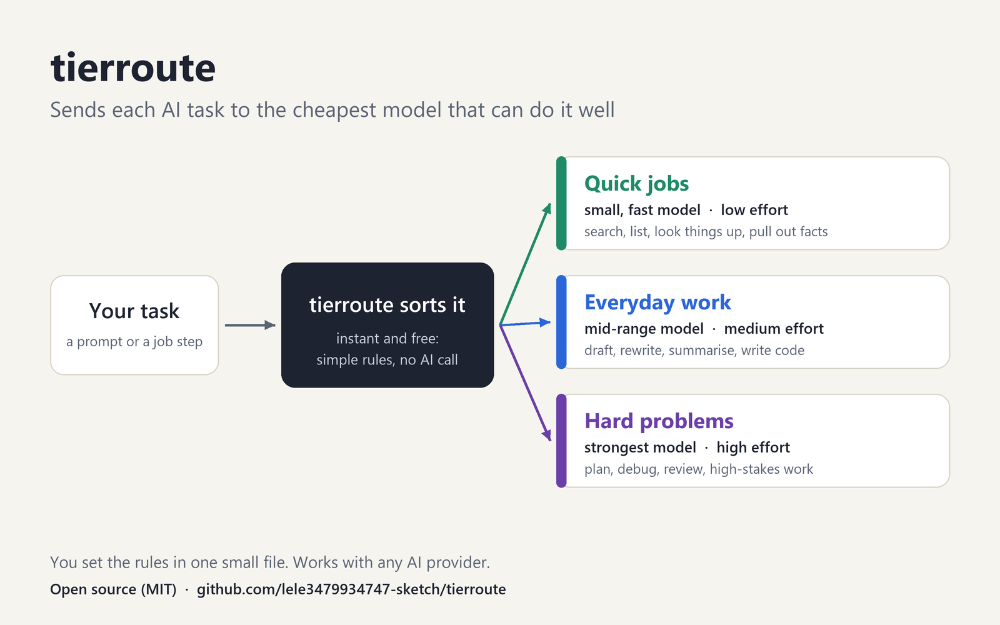
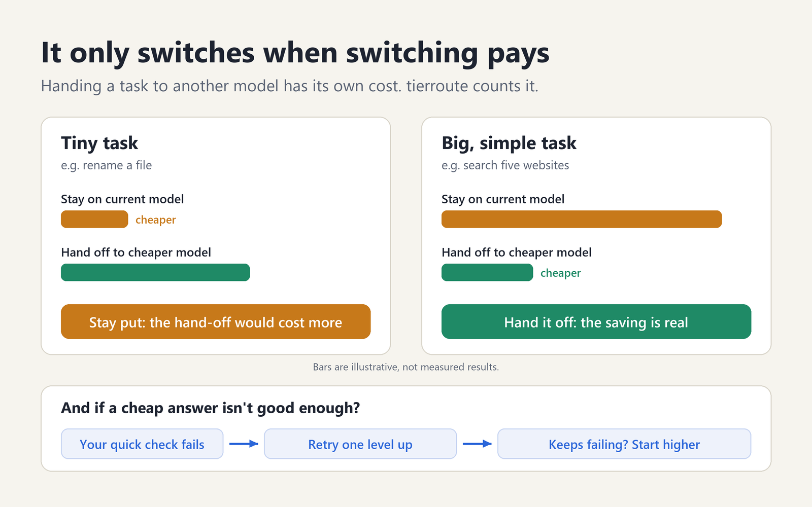

# tierroute

A tiny, dependency-free router that picks a **model** and a **reasoning effort** for each task, and only switches models when the switch actually pays.

## Why

Flagship AI models keep getting more capable, and they also use more tokens, more time and more context for every step they take. Real workflows are a mix: a little hard reasoning surrounded by many simple steps such as searching, listing, extracting and reformatting. Running all of it on the flagship means paying flagship rates for work a smaller model does just as well.

tierroute is a general-purpose router for that mix. It is not tied to one kind of task or one tool: it works for prompts typed by a person, steps inside an agent, and scheduled jobs that run on their own.



## What makes it different

Most routers compare list prices and stop there. tierroute adds the parts that decide whether routing saves money in practice:

- **Break-even rule.** Switching models has a cost: a cold start, a hand-off, a lost prompt cache. `decide()` estimates it and keeps small tasks where they are.
- **Receipts and backtest.** Every decision can be logged with its reasons, and you can replay past tasks through a config before trusting it.
- **Check, escalate, learn.** You supply a cheap check. A failure retries one tier up, and a task type that keeps failing on a tier is promoted automatically. This is counting, not training.
- **Declared routes for automated jobs.** A scheduled job states each step's task type, so routing is fixed in code and no model has to follow a hint.



Routing itself is a deterministic scoring function: no extra model call, no embeddings, no API key. Python 3.9+ standard library only.

> **Status: v0.3, not yet benchmarked against real models.** The tests cover the logic. The cost figures are estimates from the prices in your config or preset. Nothing here has been measured on live workloads yet.

## Quick start

```python
from tierroute import route

r = route("find and list new postings on three job boards")
print(r.model, r.effort)   # claude-haiku-5-5 low

r = route("draft a cover letter for this role")
print(r.model, r.effort)   # claude-sonnet-5-5 medium

r = route("find the root cause and weigh the architecture trade-off")
print(r.model, r.effort)   # claude-opus-5-5 high
```

```bash
python -m tierroute "list the files changed this week"
```

## How a tier is chosen

In order:

1. **Override.** `//haiku`, `//sonnet`, `//opus` (or `//light`, `//standard`, `//deep`) anywhere in the task forces that tier.
2. **Kind hint.** `route(task, kind="search")` maps the kind to a tier using the `kinds` table. `high_stakes=True` raises it one tier.
3. **Text score.** Deep keywords add points, standard keywords add one, light keywords subtract one. Long tasks and many-step lists add points. Unclear tasks land on `standard`.

Every result carries `reasons`, so you can see why a task went where it did.

## Break-even: switch only when it pays

If a model already holds the conversation, tell `decide()` about it:

```python
from tierroute import Router

d = Router().decide(
    "rename this file",
    kind="list",
    current_tier="deep",      # the model already in the conversation
    context_tokens=20000,     # its context, assumed cached
    est_output_tokens=50,
)
print(d.action, d.route.tier)   # stay deep
print(d.stay_cost, d.switch_cost)
```

The estimate charges the new model for a cold start, the hand-off and the task, and charges the current model one more turn to write the hand-off and read the result. A downward switch happens only when it saves at least `min_saving_ratio` (default 15%). Moving **up** for quality is never blocked by cost.

Without `current_tier` (a stateless API call you own), `decide()` just returns the route and the cost of that one call.

## Check, escalate, learn

```python
from tierroute import OutcomeStore, ReceiptLog, Router, run

router = Router(outcomes=OutcomeStore("outcomes.json"))
log = ReceiptLog("receipts.jsonl")

def call(route):
    # your code: call route.model at route.effort and return the result
    ...

def check(result):
    # your code: a cheap test, e.g. valid JSON, non-empty, passes a regex
    ...

result, route, attempts, passed = run(
    "extract the dates from this text", call, check,
    router=router, kind="extract", receipts=log,
)
```

- A failed check retries one tier up, at most `max_escalations` times (default 2).
- Each attempt is counted per task kind and tier in `outcomes.json`.
- Once a kind has at least `min_samples` runs on a tier and fails more than `max_fail_rate` of them (defaults 5 and 30%), the router starts that kind one tier higher.
- Learning applies to tasks routed with a `kind`. Tasks routed by text score alone are not learned from.

## Receipts

`ReceiptLog` appends one JSON line per decision: time, tier, model, effort, reasons and outcome. Task text is **not** stored unless you pass `store_text=True`; only a short hash and the length are written.

```bash
python -m tierroute stats receipts.jsonl
```

This prints decisions per tier, how many escalated, and the first-try pass rate per kind and tier.

## Backtest before you trust it

```bash
python -m tierroute backtest examples/tasks.jsonl --baseline deep --rows
```

The input is a `.jsonl` file (fields: `task`, and optionally `kind`, `high_stakes`, `in_tokens`, `out_tokens`, `current_tier`, `context_tokens`, `carry_tokens`) or a `.txt` file with one task per line. The output shows the tier mix, how many switches the break-even rule blocked, and estimated cost against running everything on one tier.

The result is labelled `"estimate": true` and covers cost only. It says nothing about answer quality; measure that with checks on real runs.

## Declared routes for automated jobs

```json
{
  "job": "daily-report",
  "steps": [
    {"name": "collect", "kind": "search", "task": "collect yesterday's new items"},
    {"name": "summarise", "kind": "summarise", "task": "summarise each item"},
    {"name": "final-review", "tier": "deep", "task": "check the report for errors"}
  ]
}
```

```bash
python -m tierroute plan examples/job.json
```

```python
from tierroute import load_job, plan_job
for step in plan_job(load_job("job.json")):
    print(step["name"], step["model"], step["effort"])
```

A step with no `tier` and no known `kind` raises an error. Automated steps are declared, never guessed.

## Configuration

Copy `tierroute/default_config.json`, change only what you need, and load it as an overlay:

```python
from tierroute import Router, load_config
router = Router(load_config("my_routes.json"))
```

| Key | What it sets |
|---|---|
| `tiers` | Model ID and effort for `light`, `standard`, `deep` |
| `kinds` | Task kind to tier |
| `keywords`, `length`, `thresholds` | The text scorer |
| `overrides` | Tokens such as `//opus` |
| `cost_per_mtok` | Input and output price per million tokens, per tier |
| `switching` | Cache-read factor, cold-start and hand-off sizes, default output size, `min_saving_ratio` |
| `learning` | `min_samples` and `max_fail_rate` for promotion |

## Pricing presets

The default config uses illustrative relative units, so estimates work with no setup. For real prices, load the bundled preset:

```python
from tierroute import Router, load_config
router = Router(load_config(preset="anthropic"))
```

```bash
python -m tierroute backtest examples/tasks.jsonl --preset anthropic
```

`anthropic` preset, USD per million tokens, standard API prices checked on 12 November 2026 against the [Claude pricing page](https://platform.claude.com/docs/en/about-claude/pricing):

| Tier | Model | Input | Output | Cache read | Cache write (5 min) |
|---|---|---|---|---|---|
| light | Claude Haiku 5.5 | $0.10 | $0.50 | $0.01 | $0.125 |
| standard | Claude Sonnet 5.5 | $2.00 | $10.00 | $0.10 | $2.50 |
| deep | Claude Opus 5.5 | $4.00 | $20.00 | $0.20 | $5.00 |

- Haiku 5.5 bills a whole request at higher prices ($0.50 in, $2.50 out) once the prompt passes 100,000 tokens. The preset models this with an `over` block.
- The 1-hour cache write rate is 2x base input and is not in the preset. Batch and regional pricing are not modelled.
- **Prices change.** The preset records its source and the date it was checked; confirm against the source before relying on it.
- For another provider, copy the preset, change the model IDs and prices, and pass the file to `load_config("my_prices.json")`. Each tier takes `in` and `out`, plus optional `cache_read`, `cache_write` and `over`.
- Set `"cache_handoff": true` under `switching` if the model you hand off to caches what it is given, so the hand-off is billed at the cache write rate.

## Where it fits, and where it does not

- **Fits:** code that owns the model call, such as your own app, a cloud service, an agent orchestrator or a scheduled job. There the route is enforced because your code makes the call.
- **Does not fit:** forcing the model of a chat session you do not control. Inside tools where the session model is fixed by the user, a router can only advise.

## Limits

- The text scorer is keyword and length based: cheap and predictable, not smart. Prefer `kind` hints and tune the keyword lists for your workload.
- Token counts are a rough four-characters-per-token estimate unless you pass real counts.
- The switching model is simple. It assumes the current context is cached and the new model reads everything cold.
- Promotion only moves a kind up. To move it back down, edit or delete its entry in the outcomes file.
- No benchmark on real models yet. Real prices make the estimates more realistic, not measured.

## Tests

```bash
python -m unittest discover -s tests
```

## License

MIT. See [LICENSE](LICENSE).
